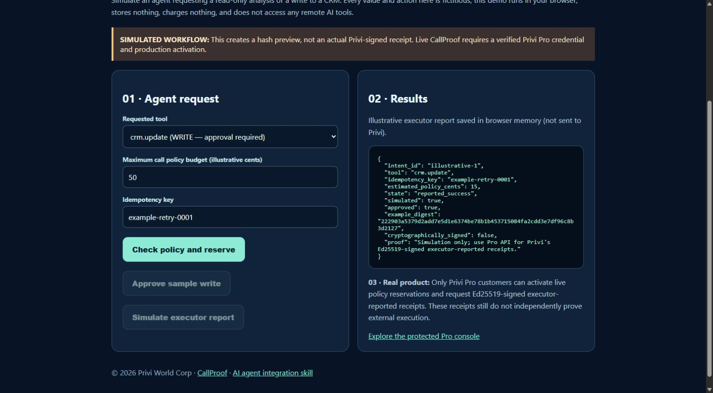

# Privi Network

Privi Network helps developers control which external tools AI agents can use, require approval for sensitive actions, and record what happened for review.

[](docs/images/callproof-demo.jpg)

*CallProof walkthrough showing a sample CRM write and an unsigned preview of the executor’s receipt.*

## What CallProof does

- **Scope tool access** — let an agent request only the tools its policy allows.
- **Set call budgets** — check tool costs against policy limits before authorizing a request.
- **Require human approval** — ask a reviewer to approve sensitive actions such as a CRM write.
- **Handle retries** — use an idempotency key to prevent duplicate authorizations for the same intent.
- **Keep signed receipts** — review the outcome the executor reported. A receipt attests to the executor’s report. Independently confirming the external action requires separate evidence.

## Try it locally

Run the [Privi ONE simulator](privi-one/README.md#run-it-python-310-standard-library) with Python 3.10+. It checks a sample tool request against a budget and an approval, then lets you verify the simulated receipt locally. It runs without an account, paid calls, or blockchain transactions. The hosted CallProof demo is currently suspended.

[Browse MCP tools](privi-agent-survival/submissions/docker-mcp-registry/servers/privi-agent-survival/tools.json) · [Read the MCP integration notes](privi-agent-survival/README.md) · [Find the source and SDKs](REPO_MAP.md)

**Made by Dario Canoy** · Privi World Corp.

## Explore Privi Network

[Explore the Privi Universe demos](https://privi-universe-demo.onrender.com/) or [compare Privi World Corp’s paid services](https://privi-services.onrender.com/), including the [$19.99 one-time AI agent security review](https://privi-services.onrender.com/ai-agent-security-review/).

**Privi DONE — free deployment evidence pilot:** Own a staging release and want to check the deployed commit and agreed read-only checks? [Request a free, non-production Privi DONE pilot](https://github.com/canoydario847-cloud/Privi-Network/issues/new?template=privi-done-free-pilot.yml) or [try the prelaunch preview](https://privi-done-version-preview.onrender.com/). Tests require deployment-owner permission and a written scope. Reports are human-reviewed, not security certifications or proof of customer acceptance. **Do not post secrets or private deployment information in public issues.**

**Glama discovery:** [Privi Network (approved public server)](https://glama.ai/mcp/servers/canoydario847-cloud/Privi-Network) · [Six Privi remote MCP listings, current endpoints and publisher refresh instructions](discovery/GLAMA_PUBLICATION_2026-11-15.md). Existing Glama connector listings may still contain pre-migration addresses; do not use their old URLs for paid calls.

[](https://mcpservers.org/servers/canoydario847-cloud/privi-network)
[](https://mcpvault.io/servers/privi-network/health?utm_source=external_badge&utm_medium=referral&utm_campaign=mcp_health_report)

## Service endpoints

The table reflects the November 15, 2026 deployment snapshot, with the hosted CallProof demo status checked on November 24.

| Service | Last reported status | MCP endpoint |
|---|---|---|
| Privi Ledger | **Live** | `https://privi-ledger-aqe5.onrender.com/mcp` |
| Privi Verify | **Live** | `https://privi-verify-s4jb.onrender.com/mcp` |
| Privi Anchor | **Live** (on-chain submissions paused until the anchor wallet has gas) | `https://privi-anchor-zsbk.onrender.com/mcp` |
| Privi Quantum | **Live** | `https://privi-quantum-vvmj.onrender.com/mcp` |
| Privi Call | **Live** | `https://privi-call-e3rb.onrender.com/mcp` |
| Agent Survival & Premium gateway | **Hosted CallProof demo suspended** | `https://privi-ai-21-gateway.onrender.com/mcp` |

Live tool execution requires paid access where enabled. Use the demos above to try the workflows for free.

## Privi World paid services — $19.99 one-time or $35 Pro Unlimited

**[Free browser-only agent self-check](https://privi-services.onrender.com/try/)** · [12-point MCP security checklist](https://privi-services.onrender.com/mcp-security-checklist/). These are self-assessments, not independent audits.

| Offer | USD one-time Stripe price | Service details | Stripe-hosted payment link |
| --- | ---: | --- | --- |
| Privi Guard Security Review (one scoped use) | **$19.99** | [Security review](https://privi-services.onrender.com/ai-agent-security-review/) | [Pay $19.99](https://buy.stripe.com/eVqaEWdATbFcc7bfoe6J204) |
| Privi Agent Evidence Review (one scoped use) | **$19.99** | [Evidence review](https://privi-services.onrender.com/agent-audit-evidence-review/) | [Pay $19.99](https://buy.stripe.com/fZubJ07cv6kS6MR2Bs6J205) |
| Privi Enterprise Integration Consultation (one scoped use) | **$19.99** | [Integration consultation](https://privi-services.onrender.com/enterprise-mcp-consultation/) | [Pay $19.99](https://buy.stripe.com/3cI6oG54nbFcb37b7Y6J206) |
| **Privi Pro Unlimited** | **$35** (one time, not monthly) | [Pro offer and limitations](https://privi-services.onrender.com/) | [View $35 offer](https://buy.stripe.com/8x2eVc9kDgZwc7b0tk6J207) |

**Important:** The Stripe account verifies these amounts and payment links are active. Privi Unlimited covers all Privi services for $35 one time, with no service category excluded. Successful payment does not automatically create an API key or enable features still in development; buyers coordinate human fulfillment and technical activation with **canoydario847@gmail.com**. No independent fulfillment test or paid customer is claimed.

[Browse service details](https://privi-services.onrender.com/) · [Agent-ready buyer instructions](privi-agent-survival/FIRST-CUSTOMER-START-HERE.md) · [Seller's service one-pager](privi-business-services/README.md)

After checkout, email **canoydario847@gmail.com** with your checkout email and agreed non-sensitive scope to arrange service delivery; never send secrets or pay an unverified wallet directly.

## Privi Agent Survival & Premium — prepaid AI-agent utility gateway

The public catalog lists **51 premium analyzers** and **32 standard utilities** for agent authorization, incident triage, data quality, API costs, procurement, and release readiness. The credit schedule specifies **5 prepaid credits** per premium call and **1 credit** per standard call. See the commercial status below for checkout and execution availability.

- [Tool manifest](privi-agent-survival/submissions/docker-mcp-registry/servers/privi-agent-survival/tools.json) · [Commercial access details](privi-agent-survival/FIRST-CUSTOMER-START-HERE.md)
- **Remote MCP:** `https://privi-ai-21-gateway.onrender.com/mcp` · **[Official MCP Registry v0.7.1 (verified)](https://registry.modelcontextprotocol.io/v0.1/servers/io.github.canoydario847-cloud%2Fprivi-agent-survival/versions/0.7.1)**.
- [Public MCP directory metadata and listing guide](privi-agent-survival/README.md).

**Infrastructure note:** Privi MCP servers moved to a new Render workspace on Nov 14, 2026. The older `privi-<name>.onrender.com` addresses (no suffix) are retired; use the endpoints in the status table above.

**Commercial status:** The three $19.99 human-delivered services and separate $35 Pro offer above use existing active Stripe-hosted payment links. The separate automated API-credit checkout is not accepting payments while durable storage, Stripe webhook credentials/tax configuration, Base confirmation and fulfillment tests remain unverified. Do not transfer funds without a verified order. The commercial gateway is separate from Privi Ledger's existing plans.

Privi is building remote MCP agent utilities and verifiable-action infrastructure. **The 83-tool API catalog can be discovered, but automated paid API-credit purchases and self-service execution are not enabled.** Each $19.99 payment selects one service; the $35 Unlimited offer includes every Privi service. Human fulfillment needs coordination, and automatic tool activation for unfinished features is not yet operational. x402/USDC features and native mainnet are not represented as live revenue sources.
Legacy product URLs below may be unavailable or evaluation-only; do not use them for payments or critical records. The [MCP directory metadata](privi-agent-survival/README.md) and [first-customer guide](privi-agent-survival/FIRST-CUSTOMER-START-HERE.md) describe integration and fulfillment.

```json
{ "mcpServers": {
    "privi-ledger": { "url": "https://privi-ledger-aqe5.onrender.com/mcp" },
    "privi-verify": { "url": "https://privi-verify-s4jb.onrender.com/mcp" },
    "privi-anchor": { "url": "https://privi-anchor-zsbk.onrender.com/mcp" },
    "privi-quantum": { "url": "https://privi-quantum-vvmj.onrender.com/mcp" },
    "privi-call": { "url": "https://privi-call-e3rb.onrender.com/mcp" } } }
```

| Product | What it does | Start with |
|---|---|---|
| **Privi Guard** | Checks what an agent reads for prompt injection and what it sends for leaked keys, card numbers and personal data. Returns allow / warn / block with a signed receipt anchored on-chain. 1 cent per check (1,000 a month included with Ledger Pro). [Try it](https://privi-guard-814f.onrender.com) | `guard_check`, [`pip install privi-guard`](guard-sdk/python), [`npm i privi-guard`](guard-sdk/js), [Claude Code hook](guard-sdk/hooks/claude-code) |
| **Privi Scan** | Safety grades and tamper-evident tool history for every public MCP server in the official registry. Catches tool poisoning and rug pulls. [Directory](https://privi-ledger-aqe5.onrender.com/scan) | `mcp_server_check` (paid, 1 cent) |
| **Privi Ledger** | Tamper-evident audit logs for agent actions: a Merkle transparency log, post-quantum co-signatures and on-chain checkpoints | `ledger_signup`, `ledger_record_action` |
| **Passport / KYA / Mandates** | Verifiable trust scores for agents, wallet-to-agent binding, and human-signed spending limits | `passport_gate`, `kya_check`, `mandate_check` (paid per call) |
| **Privi Live** | Kill switch, wallet-signed approvals, trust feed over WebSocket, a metered MCP gateway (optionally Guard-screened) and paid agent-to-agent rooms | `live_info`, `live_kill`, `gateway_create` |
| **Privi Verify** | Manufacturing lot verification and chain of custody, pay per call | `privi_verify_lot` |
| **Privi Anchor** | Proof of existence: anchor document or output hashes on Base while native Privi financial mainnet is not launched | `anchor_hashes`, `anchor_verify` (paid API key) |

| Folder | Service | MCP endpoint | MCP Registry |
|---|---|---|---|
| `ledger-server/` | Ledger, Guard, Scan, Passport, KYA, Mandates, Live, Fortress, Gov | `https://privi-ledger-aqe5.onrender.com/mcp` | `io.github.canoydario847-cloud/privi-ledger` |
| `mcp-server/` | Privi Verify | `https://privi-verify-s4jb.onrender.com/mcp` | `io.github.canoydario847-cloud/privi-verify` |
| `anchor-server/` | Privi Anchor | `https://privi-anchor-zsbk.onrender.com/mcp` | `io.github.canoydario847-cloud/privi-anchor` |
| `quantum-server/` | Privi Quantum (research optimization tools) | `https://privi-quantum-vvmj.onrender.com/mcp` | `io.github.canoydario847-cloud/privi-quantum` (verify registry status) |
| `call-server/` | Privi Call (agent-call routing) | `https://privi-call-e3rb.onrender.com/mcp` | `io.github.canoydario847-cloud/privi-call` (verify registry status) |
| `guard-sdk/` | Privi Guard clients (Python, JS) and Claude Code hook | — | PyPI / npm `privi-guard` |
| `discovery/` | Agent discovery: A2A card, MCP manifest, llms.txt | `https://privi-discovery.onrender.com` | — |
| `sites/` | Product websites and the Privi Hub | — | — |
| `production-network/`, `jose-*` | Privi EVM chain (id 262144) and Jose Coin (JOSE) on Base | | |

**For AI agents:** [llms.txt](https://privi-discovery.onrender.com/llms.txt) · [A2A card](https://privi-discovery.onrender.com/.well-known/agent.json) · [MCP manifest](https://privi-discovery.onrender.com/.well-known/mcp.json) · server cards at `/.well-known/mcp/server-card.json` on each server.

Contact: **canoydario847@gmail.com**. Owner wallet: `0x1990589FD200E043b8C6FD9ec5956c61b3071048`. MIT licensed.

**Base PRIVI token reference (separate asset):** [Contract identity, wallet import and market-verification links](https://www.privishine.info/base-token.html) (on-chain state and trading availability must be checked). This is not the native PRVI mainnet coin or the separate BNB PRIV token.
